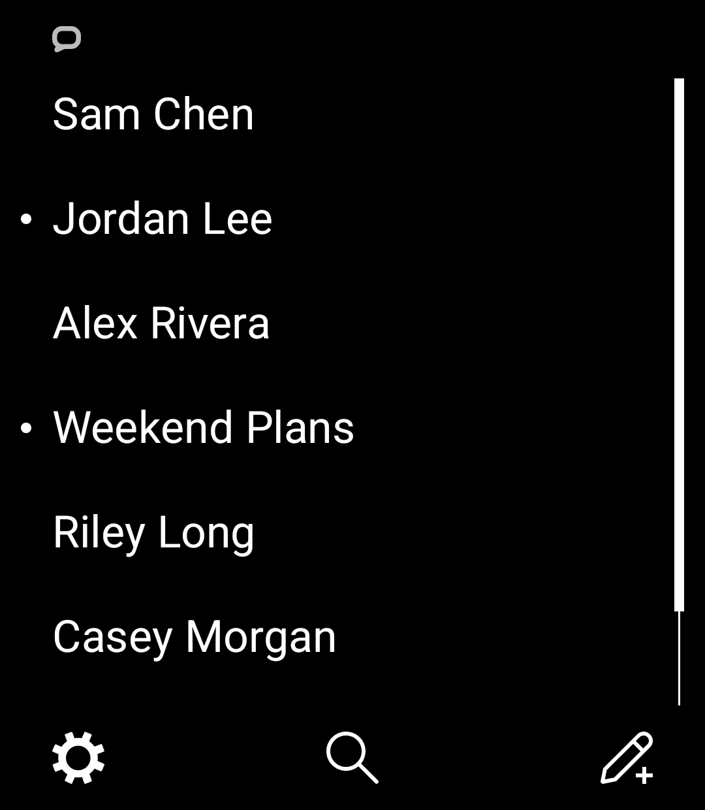
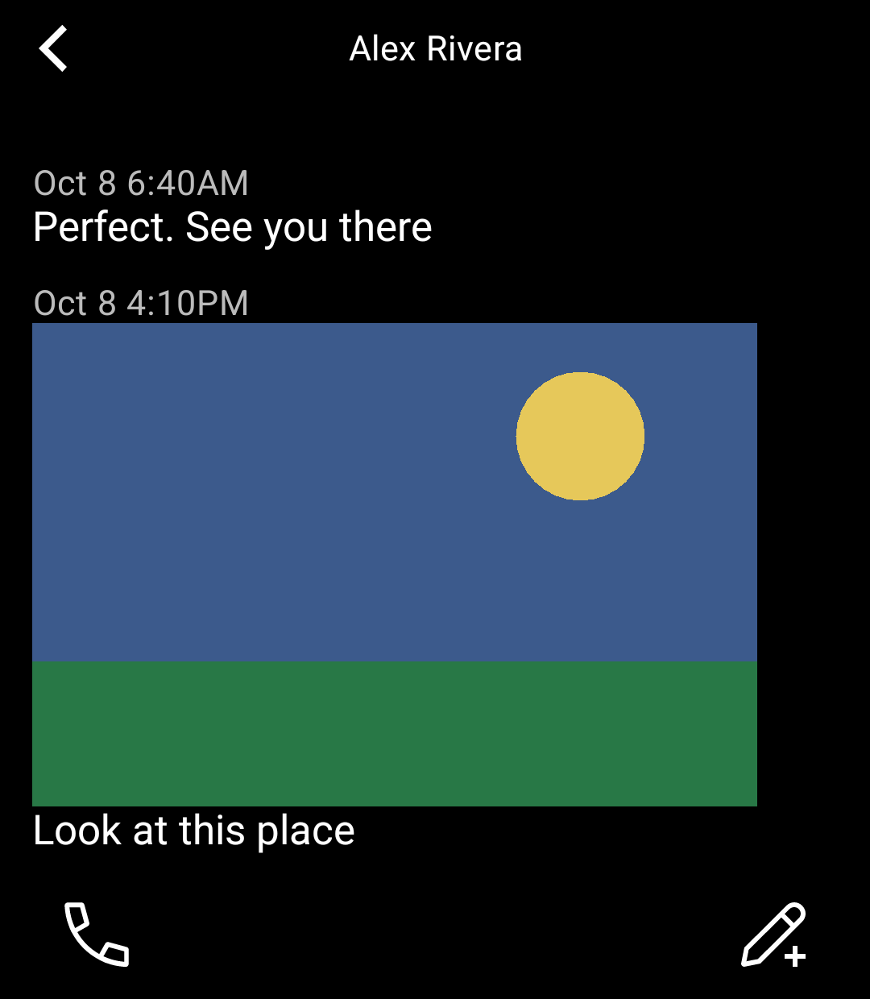
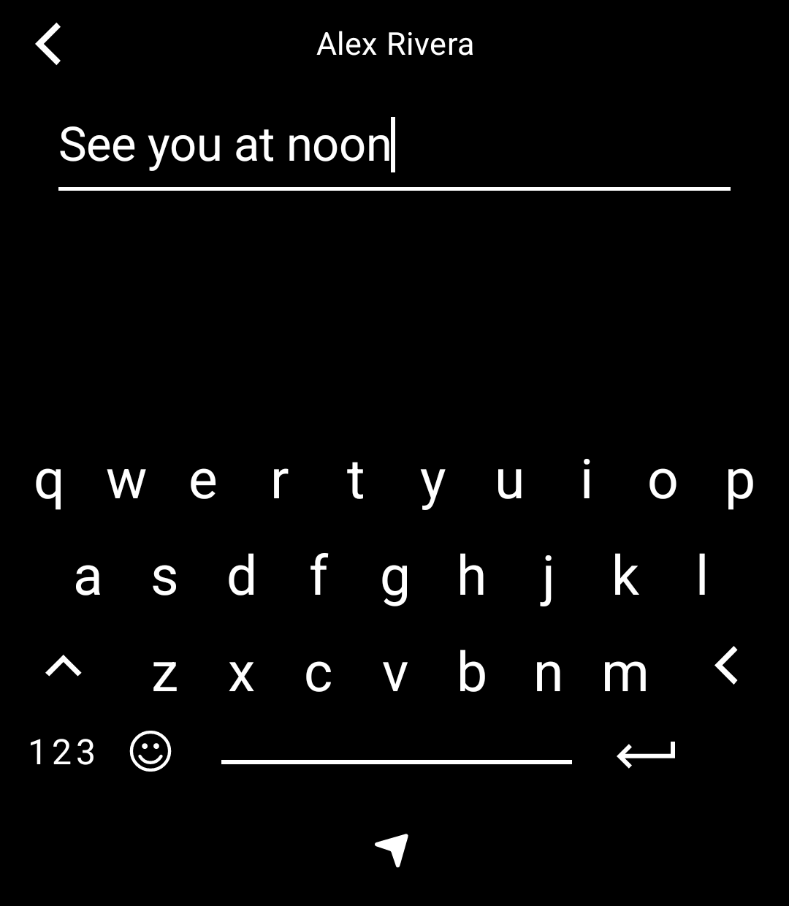
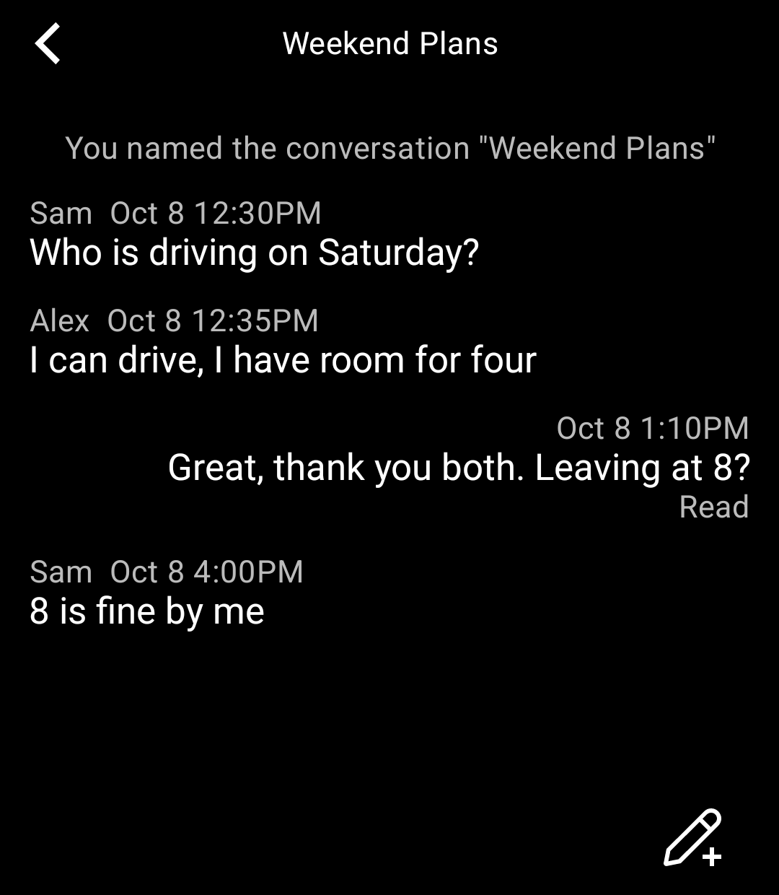
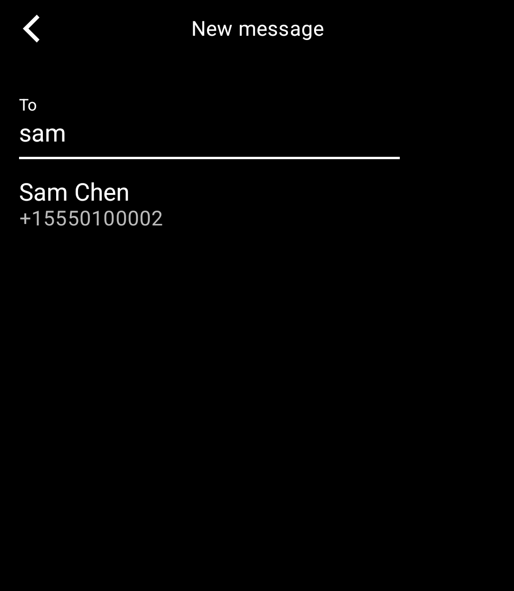
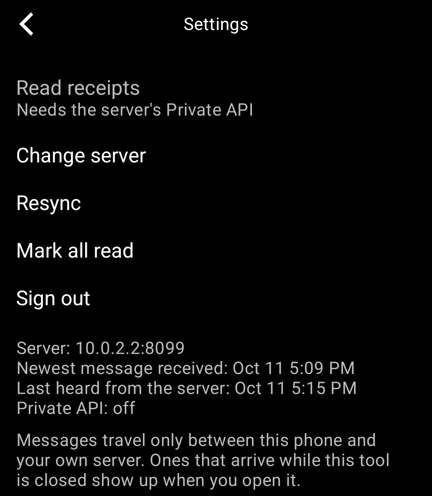

# Bubble Light

iMessage on the Light Phone III, through your own BlueBubbles server.

Bubble Light is a tool built with the [Light SDK](https://github.com/lightphone/light-sdk). It reads and sends
iMessages by talking to a [BlueBubbles](https://bluebubbles.app) server running on a Mac you own. No accounts,
no analytics, no third-party servers: the phone talks only to your server.

| Chats | Thread | Write |
|---|---|---|
|  |  |  |

| Group | New message | Settings |
|---|---|---|
|  |  |  |

The screenshots use made-up contacts from the fake server in `tools/`.

## What you need

- A Mac that stays on, signed in to Messages, running a BlueBubbles server. Setup is covered in the
  [BlueBubbles docs](https://docs.bluebubbles.app).
- A way for the phone to reach that server: the same Wi-Fi network, or a VPN such as Tailscale.
- The server address and its password.

## Setup

1. Open Bubble Light and tap SET UP.
2. Type the server address, for example `https://my-mac.example.net` or `http://192.168.1.20:1234`.
3. Type the server password. Both are stored on the phone only. The password is encrypted with a key held in
   the Android Keystore.

## What works

- Conversation list, with unread dots and contact names taken from the Mac's address book.
- Reading threads, one-to-one and group, with older history loading as you scroll up.
- Writing and sending messages, starting new conversations by name, number or email.
- Photos in messages, with a full-screen viewer (pinch to zoom, double tap to reset).
- Tapbacks shown as a line under the message they belong to.
- Delivered and Read status on your newest message.
- Calling a contact: the call button hands the number to LightOS's dialer.
- Live updates while the tool is open.
- Optional read receipts, when the server's Private API is available.

## What it does not do, and why

- **No notifications while the tool is closed.** A Light tool cannot run a background service, and the SDK's
  push channel is built for Light's own push service, which a self-hosted BlueBubbles server has no way to
  feed. Messages that arrive while the tool is closed appear as soon as you open it. Live delivery runs only
  while the tool is on screen.
- **No sending photos or files.** The SDK gives a tool no access to the camera app or the photo picker.
  Receiving and viewing photos works.
- **Tapbacks, typing indicators and edits cannot be sent**, and the password is visible while you type it,
  because the Light keyboard editor has no masked mode.

## Privacy

Everything stays between the phone and your server. There is no analytics, no tracking and no advertising.
`tool/lighttool.toml` declares only the internet permission and the `cleartext-http` capability, which lets the
tool reach a server on your home network over plain HTTP. The SDK's own libraries add a few more permissions
to every tool's manifest; this tool does not use them. Use HTTPS or a VPN when the server is reachable from
outside your home network.

## Why BlueBubbles and not OpenBubbles

[OpenBubbles](https://github.com/OpenBubbles/openbubbles-app) is a separate project that implements Apple's
protocol itself, inside a Flutter app with native Rust code. It has no server API for another app to call, and
the Light SDK does not allow bundling native libraries like that. BlueBubbles exposes a documented REST and
Socket.IO interface, which is what this tool uses.

## Building from source

This repository is a fork of [Light's tool SDK](https://github.com/lightphone/light-sdk) at the `v0.2.0` tag.
The tool lives entirely under [`tool/`](tool).

1. Follow the SDK's [Quickstart](https://github.com/lightphone/light-sdk#quickstart) for the GitHub Packages
   token and an emulator.
2. `./gradlew :tool:assembleDebug`

Light's builder compiles only the `tool/` module, against its own pinned copy of the SDK, so write against the
SDK API at the tag the builder uses.

### Trying it without a Mac

`tools/FakeBlueBubbles.java` is a stand-in server with made-up conversations, including a Socket.IO feed.

```
java tools/FakeBlueBubbles.java 8099 fake
```

From the Android emulator the host is `http://10.0.2.2:8099` and the password is `fake`. While it runs:

- `/admin/incoming?password=fake&text=hello&from=%2B15550100001` pushes a new message over the socket.
- `/admin/drop` closes every socket and `/admin/mute` stops the heartbeat, to exercise reconnecting.

To run in the LightOS emulator, set `serverPackage = "com.thelightphone.sdk.emulator"` in
`tool/lighttool.toml` and build with `-DlightSdk.allowAltServerPackage=true`, then set the emulator's client
filter to allow all APKs.

## Credits

The BlueBubbles client code is based on [craigeley/chat](https://github.com/craigeley/chat) (MIT), reworked for
a Room database and the Light SDK. See [NOTICE.md](NOTICE.md). Light, Light Phone and LightOS belong to Light.
This is an unofficial community tool, not affiliated with or endorsed by Light, Apple or BlueBubbles.

## License

MIT, inherited from [Light's SDK](LICENSE).

If Bubble Light is useful to you, [buy me a coffee](https://ko-fi.com/jabberbox) to help keep it going.
